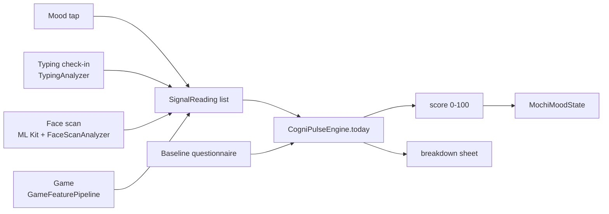

# ZENO architecture

This describes the app as it is in the code today. If something here disagrees with the code, the code wins and this file needs fixing.

## Shape of the app

ZENO is a single Flutter app with no server. State lives in Riverpod, data lives on the phone (SharedPreferences, plus SQLite for game sessions), and the only network call is an optional request to an Ollama server on the local network.

```mermaid
flowchart TD
    subgraph UI
        S[screens/*] --> W[widgets/*]
    end
    subgraph State
        P[AppStateNotifier<br/>providers/app_state_provider.dart]
        MP[mochiPersonalityProvider]
    end
    subgraph Logic["Pure logic (services/)"]
        CE[CogniPulseEngine]
        PE[ProgressEngine]
        IE[InsightEngine]
        WL[WeeklyLetter]
        TA[TypingAnalyzer]
        FA[FaceScanAnalyzer]
        GP[GameFeaturePipeline]
        GR[GameRecommender]
    end
    subgraph Storage
        WR[WellnessRepository] --> SP[(SharedPreferences)]
        FR[FaceScanRepository] --> SP
        GRP[GameRepository] --> DB[(SQLite zeno_games.db)]
        GRP -. fallback .-> SP
    end
    OL[OllamaService] -. 3 s timeout .-> OS((Ollama llama3.2))

    S --> P
    S --> TA & FA
    W --> P & MP
    P --> CE & PE & IE & WL & GR
    P --> WR & FR
    S --> GP --> GRP
    W --> OL
```

The layers only call downward. Screens read and call the notifier; the notifier holds the in-memory `AppState`, writes through repositories, and gets every derived number (score, level, streak, badges, insights) from the pure engines. The engines take plain lists and a `DateTime now`, so tests can drive them without Flutter or storage.

## State

`AppStateNotifier` (`lib/providers/app_state_provider.dart`) owns one immutable `AppState`:

| Field | What it is |
|---|---|
| `signals` | every `SignalReading` (type, 0 to 100 score, time, optional stress and mood) from the last 60 days |
| `xpEvents` | every XP award (source, source id, amount, time) |
| `baseline` | the onboarding questionnaire answers, or null if skipped |
| `counters` | Mochi taps, breathing sessions |
| `faceScans` | the last 20 face scans, newest first |
| `asOf` | the clock reading used for "today"; refreshed on resume and at midnight by `DayRolloverWatcher` |
| `scoreOverride` | developer-panel override, memory only |

Everything a screen shows is a getter on `AppState`: `cogniPulseScore`, `breakdown`, `weekDays`, `totalXp`, `questsDoneToday`, `recommendedGameId`, and `user` (level, streak and badges). Nothing is stored twice, so XP, level and the score can't drift apart.

Small providers expose slices: `cogniPulseProvider`, `mochiMoodProvider`, `questsProvider`, `userProvider`, `isOllamaLiveProvider`. `appClockProvider` returns `DateTime.now` and is overridden in tests to move time.

Actions that change state: `logMood`, `recordTypingCheckIn`, `recordFaceScan`, `recordGameResult`, `completeQuest`, `recordBreathingSession`, `saveBaseline`, `updateUserName`, `completeOnboarding`, `resetAllData`, `seedDemoWeek`, `setScoreOverride`, `refreshClock`.

## Navigation

`go_router` (`lib/router/app_router.dart`). The app starts at `/splash`. A redirect sends anyone who hasn't finished onboarding to `/onboarding`. After that, a `StatefulShellRoute.indexedStack` holds six tabs, `/home`, `/quests`, `/playroom`, `/scan`, `/insights` and `/profile`, under a floating nav bar. Every page uses a fade transition.

Games are pushed on the root navigator so the nav bar never covers them.

Onboarding runs Welcome, Name, Avatar, Baseline (5 questions), Permissions, then Meet Mochi.

## How CogniPulse is computed

`CogniPulseEngine` (`lib/services/cognipulse_engine.dart`).

1. Take today's readings and keep the latest one of each type.
2. Score = Σ(score × weight) / Σ(weight), over the types measured today plus the baseline.
3. Weights: typing 0.35, face 0.20, self-report 0.15, game 0.15, baseline 0.10. Phone usage (0.30 in the PRD) isn't measured, so it never enters the sum, and the breakdown lists it as "not measured".
4. With no check-ins today the score is the baseline answer, or 60 if onboarding was skipped.

`lastDays` runs the same fusion for each of the last 7 calendar days for the Insights chart, using calendar arithmetic so a daylight-saving change can't skip a day.

Mood bands (`lib/models/mochi_state.dart`): 80 and up is Thriving, 55 to 79 Balanced, 30 to 54 Drifting, below 30 Struggling. The band sets Mochi's colours, expression, breathing speed (1.8 s to 4.5 s per breath) and dialogue.

### Signal formulas

**Typing** (`typing_analyzer.dart`): `100 × (0.35·accuracy + 0.25·speed + 0.25·(1 − corrections) + 0.15·(1 − pauses))`. Accuracy is 1 − edit distance / length, speed is WPM / 40 capped at 1, corrections is backspaces per keystroke × 4 capped at 1, and pauses is the share of gaps over 1.5 s. Pasted text is rejected.

**Face scan** (`face_scan_analyzer.dart`): the camera streams NV21 frames to ML Kit for 5 seconds. Per frame we keep smile probability, both eye-open probabilities, head yaw and roll, and how centred the face is. From the averages:

- mood = 30 + 55·smile + 10·centred + 5·coverage
- focus = 30 + 45·eyes + 15·yawStability + 10·centred
- stress = 100 − (28·smile + 18·eyes + 20·yawStability + 14·rollStability + 10·centred + 10·coverage)
- score = 0.34·mood + 0.33·focus + 0.33·(100 − stress)

yawStability = 1 − |yaw|/35° and rollStability = 1 − |roll|/25°, each clamped to 0 to 1. Coverage is the share of frames that found a face. These weights are hand-picked, not trained. The TFLite model in `ml/` is not loaded by the app.

**Games** (`game_signal_collector.dart`, `game_feature_pipeline.dart`): each game records taps with reaction time, pressure and hit/miss. At the end of a game the collector computes error rate, mean reaction, pressure variance and hesitation (share of taps slower than 1.5× the player's baseline). The pipeline turns the last 7 days into z-scores of the latest game against the player's own history, combines them into a stress load, and maps that to a game signal between 30 and 90 (60 = playing like you usually do). A game quit early gives no signal and no XP.

**Mood tap**: five faces, Struggling to Thriving, logged as 10, 30, 50, 70 or 90.

## Progress

`ProgressEngine` (`progress_engine.dart`) is pure. Level = XP ÷ 250 + 1. The streak counts consecutive days with any check-in and stays alive until today ends. Badges unlock from real counts (check-ins, early check-ins, longest streak, Mochi taps, days above 80, breathing sessions, a night check-in) and show progress toward their target.

XP sources: first check-in of each type per day (mood 5, typing 15, face 15), quests (20 to 60), finished games.

## Insights and the weekly letter

`InsightEngine` produces rule-based cards from the last 7 days: the trend (needs 3 days with data), the best day, morning vs evening (needs 2 check-ins on each side and an 8-point gap), typing stress far above the mood rating (25-point gap), and consistency. `WeeklyLetter` writes Mochi's letter from the same numbers and says plainly when there's no data.

## Mochi

`MochiWidget` draws Mochi with a `CustomPainter` (head, ears, eyes, belly) from the current mood. One `AnimationController` drives breathing whose period follows the mood, and others handle blinks, ear twitches and the tap bounce. Thriving adds a sparkle `ParticleOverlay`. Mochi is never a static image.

Dialogue comes from `mochiPersonalityProvider` (mood, time of day, name, streak, score change) and, when available, `OllamaService`. That service sends one prompt to `/api/generate` with model `llama3.2` and a 3-second timeout. Any error or timeout falls back silently to the built-in lines in `mock_data.dart`. The host defaults to `10.0.2.2:11434` on Android (the emulator's address for the computer) and `localhost:11434` elsewhere, and can be changed in the developer panel (`zeno.ollama_host`).

## Storage

| Key / table | Owner | Contents |
|---|---|---|
| `zeno.signals` | WellnessRepository | signal readings, trimmed to 60 days |
| `zeno.xp_events` | WellnessRepository | XP awards |
| `zeno.baseline` | WellnessRepository | questionnaire answers |
| `zeno.counters` | WellnessRepository | Mochi taps, breathing sessions |
| `zeno.user_name` | WellnessRepository | display name |
| `zeno.face_scan_history` | FaceScanRepository | last 20 scans |
| `onboarding_complete` | AppStateNotifier | onboarding gate |
| `zeno.ollama_host` | OllamaSettings | Ollama address, kept by "Reset all data" |
| `zeno_games.db`: `game_sessions`, `game_baselines`, `game_touch_events` | GameRepository | game play (falls back to `zeno.game_*` prefs keys where SQLite is unavailable) |

Corrupt JSON loads as empty rather than crashing. "Reset all data" removes every key above except the Ollama host and clears the game tables.

## Testing

`flutter test` runs 156 tests: unit tests for every engine and repository, and widget tests for each screen's key flows (onboarding to home, mood tap moving the score, typing check-in, breathing quest, game end to results, every game opening on a phone-sized screen, developer panel, reset). Line coverage is about 81% (`dart run tool/coverage_summary.dart`). The camera-driven parts of the Scan screen can't run under `flutter test`, so they're covered by the analyzer tests plus a manual check on a phone.

Test conventions:

- Engines take `now` as a parameter; widget tests override `appClockProvider`.
- `SharedPreferences.setMockInitialValues({})` gives each test empty storage. `GameRepository` falls back to it automatically because sqflite has no plugin under `flutter test`.
- Widget tests set `GoogleFonts.config.allowRuntimeFetching = false` and finish with `pumpWidget(SizedBox())` then `pump(30 s)` so Mochi's idle timers are flushed.

CI (`.github/workflows/ci.yml`) runs `flutter analyze --fatal-infos`, the tests with coverage (floor 75%), and a debug APK build on every push and pull request.
